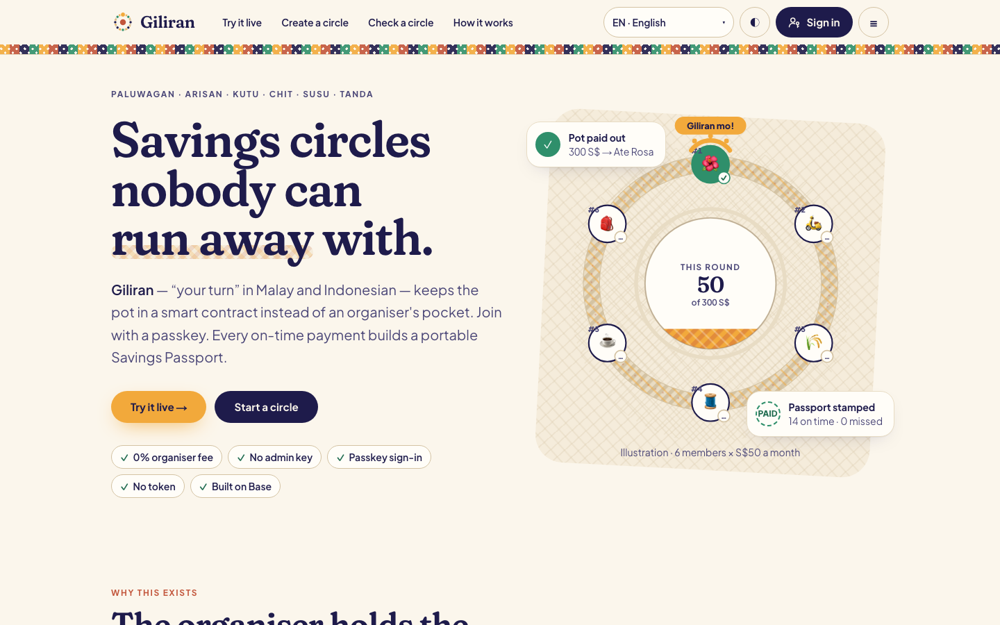
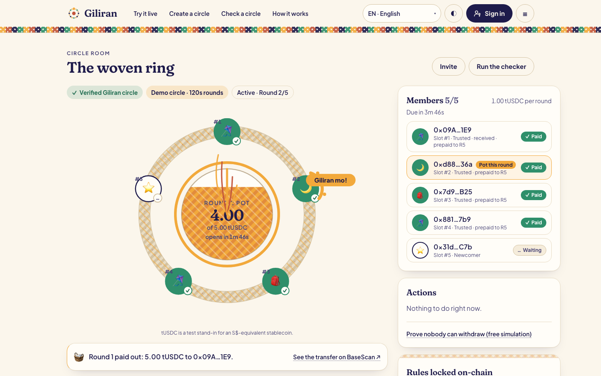
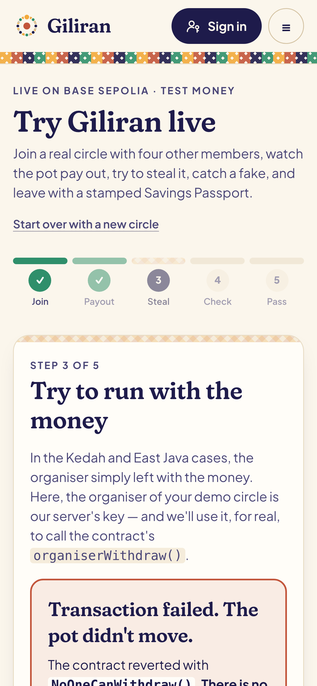
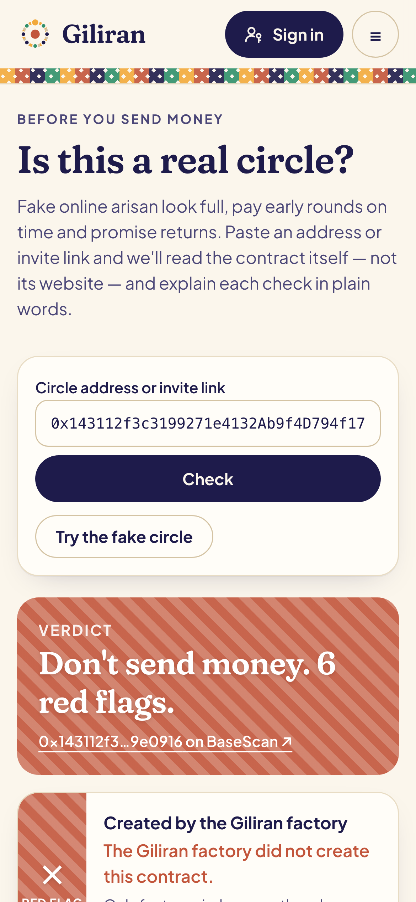
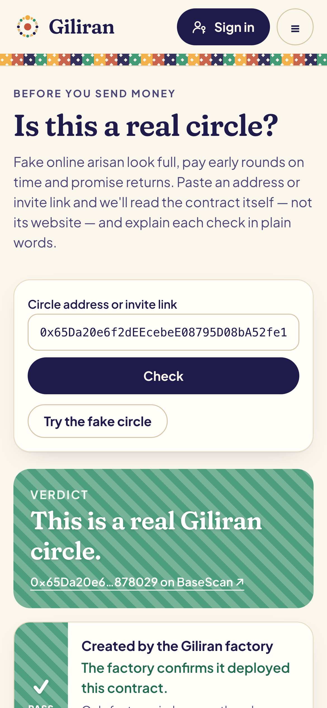
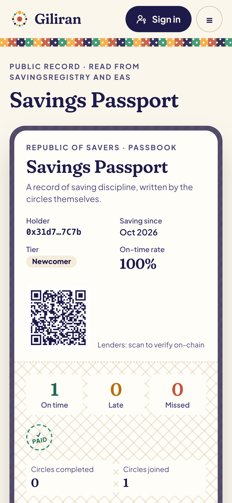
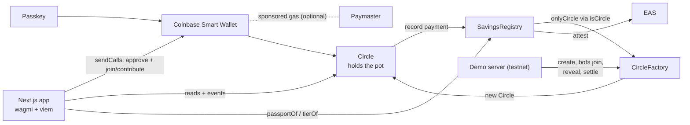

# Giliran

**Savings circles nobody can run away with.**

Giliran ("your turn" in Malay and Indonesian) is a rotating savings circle — paluwagan, arisan, kutu, chit, susu, tanda — where a smart contract holds the pot instead of an organiser. Members join with a phone passkey, with no seed phrase and no gas to buy. Every on-time payment builds a portable credit record, the **Savings Passport**.

- **Live app:** https://giliran-umber.vercel.app
- **Try it in 3 minutes:** https://giliran-umber.vercel.app/demo · [judge walkthrough](docs/JUDGES.md)
- Built for the Tech Track of *Web3 for Social Good 2026* (DoraHacks · SMU · GSR Foundation · University of Málaga).



## The problem

Rotating savings circles are how millions of people save, especially women and overseas workers. But **the organiser holds the money, so the organiser is the single point of failure**:

- **Kedah, Malaysia (Aug 2026):** 35 police reports over about RM1.7M after a kutu organiser couple went missing. ([NST](https://www.nst.com.my/news/nation/2026/08/1507751/duit-kutu-rm17mil-losses-35-reports-lodged), [The Star](https://www.thestar.com.my/news/nation/2026/08/06/couple-reported-missing-detained-over-alleged-039kutu039-scam))
- **Pasig, Philippines (Jan 2024):** an NBI probe into a "paluwagan" operation with at least ₱800M involved; it promised 40% profit. ([Daily Tribune](https://tribune.net.ph/2024/01/08/nbi-probes-ponzi-like-scheme-in-pasig), [Philstar](https://www.philstar.com/nation/2024/01/10/2324673/nbi-probes-p1-billion-paluwagan-scam))
- **East Java, Indonesia (Aug 2026):** a fake online arisan moved about Rp71 billion through about 140 victims. It was promoted by Instagram influencers, padded with made-up members, and paid early rounds on time to look real. ([ANTARA](https://www.antaranews.com/berita/5691727/polda-jatim-ungkap-arisan-online-bodong-rp71-miliar), [CNN Indonesia](https://www.cnnindonesia.com/nasional/20260813071833-12-1391680/arisan-online-bodong-rp71-m-di-jatim-selebgram-ikut-promosi))

Two more gaps: years of disciplined saving leave **no credit record** at any lender, and circles of overseas workers span several countries, so there is **no single shared savings pool**.

**Primary users:** overseas Filipino workers in Singapore, Hong Kong and Dubai — 2.19 million in 2024, 57% of them women ([PSA via GMA News](https://www.gmanetwork.com/news/pinoyabroad/dispatch/969755/ofws-grew-to-2-19m-in-2024-psa/story/)) — who save with friends and family. Paying out to family at home is one feature, and it can run through any licensed remittance or off-ramp partner.

## How it works

1. **Join with your phone.** A passkey creates a Coinbase Smart Wallet. One tap batches approve + join (EIP-5792), with gas sponsored when a paymaster is configured.
2. **The contract holds the pot.** Each member pays one contribution as a deposit. Every round everyone pays in; the last payment sends the whole pot to that round's member in the same transaction. After a grace period anyone can settle a round, covering unpaid members from their deposits.
3. **Fair, reputation-tiered order.** The organiser commits to a secret before anyone joins; once the circle fills, the secret plus the next block's hash shuffles the order. Members with a record go first; **newcomers always take the last slots**, so they save before they collect and can't default on anyone.
4. **Savings Passport.** A `SavingsRegistry` (writable only by factory circles) counts on-time, late and missed payments and completed circles, and writes an EAS attestation for each outcome.
5. **"Is this a real circle?"** A checker reads any contract's claims (fee, promised return, pot size, member deposits, owner) and explains each red flag in plain words.



| Run with the money? Reverted. | Checker: fake | Checker: real | Passport |
| --- | --- | --- | --- |
|  |  |  |  |

## Contracts (Base Sepolia, chain 84532)

All verified on Sourcify (exact match) and BaseScan. Addresses mirror [`contracts/deployments/base-sepolia.json`](contracts/deployments/base-sepolia.json).

| Contract | Address |
| --- | --- |
| CircleFactory | [`0xB6df90C10AA6c2A82Dee5098EE84ad4b388AD72D`](https://sepolia.basescan.org/address/0xB6df90C10AA6c2A82Dee5098EE84ad4b388AD72D#code) · [Sourcify](https://repo.sourcify.dev/contracts/full_match/84532/0xB6df90C10AA6c2A82Dee5098EE84ad4b388AD72D/) |
| SavingsRegistry | [`0x61728262F2f15180688d95fEF0977340CaA1F7cf`](https://sepolia.basescan.org/address/0x61728262F2f15180688d95fEF0977340CaA1F7cf#code) · [Sourcify](https://repo.sourcify.dev/contracts/full_match/84532/0x61728262F2f15180688d95fEF0977340CaA1F7cf/) |
| MockUSDC (tUSDC) | [`0x2fc1E875f52a0afe38d7a49ddEDE67136EB096E0`](https://sepolia.basescan.org/address/0x2fc1E875f52a0afe38d7a49ddEDE67136EB096E0#code) · [Sourcify](https://repo.sourcify.dev/contracts/full_match/84532/0x2fc1E875f52a0afe38d7a49ddEDE67136EB096E0/) |
| FakeCircleDemo (teaching example) | [`0x143112f3c3199271e4132Ab9f4D794f17c9e0916`](https://sepolia.basescan.org/address/0x143112f3c3199271e4132Ab9f4D794f17c9e0916#code) · [Sourcify](https://repo.sourcify.dev/contracts/full_match/84532/0x143112f3c3199271e4132Ab9f4D794f17c9e0916/) |
| EAS schema | [`0x12b4af44…0287`](https://base-sepolia.easscan.org/schema/view/0x12b4af445a773901e40c16dfdfbd1a1585892a6092ef1f81423e89c522390287) — `address circle, uint32 round, uint8 status, uint64 paidAt` (non-revocable) |
| EAS / SchemaRegistry | OP-Stack predeploys `0x4200…0021` / `0x4200…0020` |
| USDC (also accepted) | `0x036CbD53842c5426634e7929541eC2318f3dCF7e` |

Each `Circle` is deployed by the factory with `new`; `CircleFactory.isCircle(address)` is the source of truth.

## Architecture



More detail, including the lifecycle state machine: [docs/ARCHITECTURE.md](docs/ARCHITECTURE.md). Threats and mitigations: [docs/THREAT_MODEL.md](docs/THREAT_MODEL.md).

## Web3 components

| Component | Job it does |
| --- | --- |
| `Circle` contract | Holds the pot and enforces the rules. No owner, admin key, upgrade, pause or withdraw path. |
| `CircleFactory` | Deploys circles, validates config (2–20 members, minimum round lengths, allowed tokens), vouches with `isCircle`. |
| `SavingsRegistry` | The Savings Passport: per-member counts and reputation tier; only factory circles can write. |
| EAS attestations | A portable, independently verifiable record of every payment outcome. |
| Commit-reveal + blockhash | Fair payout order without trusting the organiser; fallback draw if they stall. |
| Coinbase Smart Wallet (passkey) | Sign in with Face ID / fingerprint; no seed phrase. |
| EIP-5792 `sendCalls` (+ paymaster) | One tap for faucet + approve + action; sponsored gas when configured. |
| Stablecoin (tUSDC / USDC) | The unit of saving. |
| **No token** | There is no Giliran token, and there won't be. |

## Legal by design

Singapore's Chit Funds Act and Malaysia's Kootu Funds (Prohibition) Act draw the line at fees, profit and public promotion. The contract enforces:

- the organiser's fee is a hard-coded zero (`FEE_BPS = 0`);
- a payout can never exceed what members paid in, so no "returns" are possible (`promisedReturnBps() = 0`, invariant-tested);
- circles are invite-only, with no public listing, directory or by-creator view;
- a circle has at most 20 members.

**A legal opinion per country is still required before any real pilot.**

## Prior work

WeTrust (2017) put lending circles on Ethereum and showed the idea works, but it required crypto wallets and its own token. Giliran uses passkeys, sponsored gas and no token, sets payout order by reputation, enforces zero-fee rules in code, and adds the Savings Passport.

## Limitations

- A legal opinion per country is needed before any pilot.
- Off-ramps to pesos, ringgit or rupiah require a licensed partner and KYC.
- Amounts are visible on-chain, though not linked to identities. Coinbase Smart Wallet uses one account per passkey, so members don't yet get a fresh account per circle.
- Commit-reveal is weaker than VRF (a block producer could influence `blockhash`).
- A member can still default after collecting their pot. The deposit, tiering and public missed-payment attestations reduce this but cannot eliminate it.
- No paymaster is configured on the live demo yet; instead the demo server drips a little test ETH (0.0004) to each new judge wallet for gas. The sponsored path is implemented and activates when `NEXT_PUBLIC_PAYMASTER_URL` is set.
- The demo server's rate limit is per serverless instance unless Upstash/Vercel KV is configured. Demo commit secrets are derived with an HMAC, so reveals don't depend on storage.
- `organiserWithdraw()` from a smart wallet can't land on-chain (the wallet simulates and refuses a guaranteed revert), so the demo sends it from the circle's organiser key; members can still run the free simulation from their own wallet.
- Not audited. Testnet only.

## Roadmap

- Chainlink VRF for the payout order.
- A guarantor stake for early slots.
- Guardian recovery, with circle members as 2-of-3 guardians.
- A peso off-ramp partner.
- Pilots with overseas-worker groups.

## Local setup

Requirements: Foundry, Node 22+, pnpm 8+.

```bash
git clone --recursive https://github.com/sambitsargam/giliran && cd giliran

# Contracts
cd contracts
forge build && forge test -vv
cp .env.example .env              # DEPLOYER_PRIVATE_KEY, optional BASESCAN_API_KEY
forge script script/Deploy.s.sol --rpc-url base_sepolia --broadcast
forge script script/RegisterSchema.s.sol --rpc-url base_sepolia --broadcast
./script/verify.sh

# Web
cd ../web
pnpm install
pnpm sync:deployments             # copies addresses + ABIs from contracts/
cp .env.example .env.local        # demo keys are server-only
pnpm dev                          # http://localhost:3000

pnpm lint && pnpm typecheck && pnpm test && pnpm build && pnpm test:e2e
```

Demo bots: `pnpm bots:fund` (tUSDC faucet; `--eth` also tops up gas from the deployer), `pnpm bots:bootstrap` (one bot-only circle so bots reach tier 1), `pnpm bots:recycle` (refund abandoned demo circles and settle due rounds). Each bot needs about 0.003 Base Sepolia ETH.

## Licence

MIT
