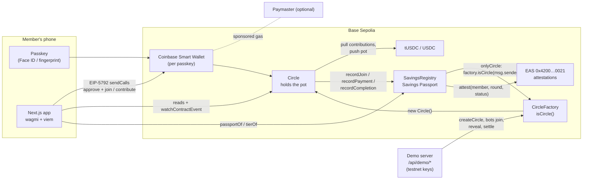
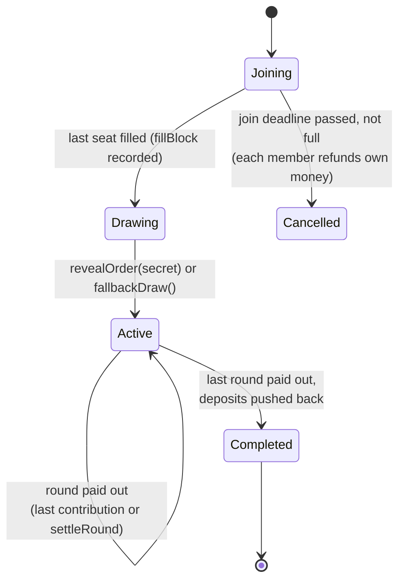

# Architecture

Giliran has three on-chain contracts, a Next.js app, and a small demo server used only for the guided demo. There is no database for real circles: the chain is the database.

## Contracts

| Contract | Job | Notes |
| --- | --- | --- |
| `Circle` | Holds the pot for one circle and enforces every rule. | No owner, admin, pause, upgrade or withdraw. `FEE_BPS = 0`. `organiserWithdraw()`, `receive()` and `fallback()` always revert with `NoOneCanWithdraw()`. |
| `CircleFactory` | Deploys circles with `new Circle(...)`, validates config, records `isCircle`. | Accepts only tUSDC and Circle's USDC (fixed at deploy). No discovery views. |
| `SavingsRegistry` | Per-member counts (on-time, late, missed, completed, joined, first seen) and `tierOf`. | Writable only by factory circles. Writes one EAS attestation per payment outcome; a failing attestation never blocks a payment. |
| `MockUSDC` | 6-decimal test stablecoin with a 100 tUSDC / 24h faucet. | Deployer has no mint power. |
| `FakeCircleDemo` | Teaching example for the checker. | Claims 10 members (7 without deposit), 5% fee, 20% return, owner can withdraw. |

### Circle lifecycle

- **Rounds** follow a fixed schedule from the draw: round *r* opens at `startTime + (r-1) * roundDuration`, is due at the end of that window, and can be settled by anyone after `graceDuration` more. A round can't pay out before it opens, so fully prepaid circles still follow the calendar.
- **Payout** happens in the same transaction as the last contribution (or prepay, or `settleRound`). The pot is `contribution × paid members + amounts taken from deposits`, so it can never exceed what came in.
- **Missed payments** after grace are covered from the member's deposit. If the deposit is exhausted the recipient gets what was collected and `Shortfall` is emitted.
- **Deposits** are pushed back on completion. If a push fails (for example a blacklisted USDC address) the amount is credited to `owed` and can be pulled with `claimOwed()`, so one bad recipient can't freeze the circle.

### Fair order

1. At creation the organiser commits `keccak256(abi.encode(secret, organiser))`.
2. When the circle fills, `fillBlock` is recorded.
3. `revealOrder(secret)` (after `fillBlock + 1`) seeds a shuffle with `keccak256(secret, blockhash(fillBlock + 1))`. A reveal after 256 blocks is refused because the hash would read as zero.
4. If the organiser doesn't reveal within `roundDuration` (10 minutes for demo circles), anyone calls `fallbackDraw()`, seeded from a later block.
5. Members are bucketed by registry tier (2, 1, 0) and Fisher-Yates-shuffled within each tier. Tier-0 newcomers always take the last slots.

### Invariants (tested)

- The circle's token balance is always at least `outstanding()` (deposits + prepaid future rounds + credits).
- `totalPaidOut + totalDepositsReturned <= totalPaidIn`, with equality once a circle completes.

## Web app

- **Wallet:** wagmi v2 with the Coinbase Smart Wallet connector (`preference: 'smartWalletOnly'`) as the primary passkey path, plus EIP-6963-discovered browser wallets in the sign-in sheet.
- **Writes:** `useTx` checks wallet capabilities. With atomic batching it sends one EIP-5792 `sendCalls` (faucet + approve + action); with `NEXT_PUBLIC_PAYMASTER_URL` set and a paymaster-capable wallet it adds `paymasterService`. Otherwise it falls back to sequential writes. Every transaction gets a toast with a BaseScan link.
- **Reads:** two multicalls per circle (`useCircle`), refreshed by `watchContractEvent` with 6-second polling as fallback.
- **Passport:** `passportOf` / `tierOf` from the registry, plus recent attestations from the EAS GraphQL indexer.
- **Checker:** reads any address through the `ICircleView` surface, plus `isCircle` and `owner()`, and turns the numbers into plain-language checks (`src/lib/checker.ts`, unit tested).
- **Privacy:** display names and avatars live in `localStorage` and invite links only.

## Demo server

`/api/demo/*` route handlers hold the deployer and four bot keys server-side (testnet only):

| Route | What it does |
| --- | --- |
| `POST /api/demo/new` | Creates a demo circle (5 members, 1 tUSDC, 120 s rounds, 30 s grace), seats four bots with `joinWithPrepay(5)`, drips gas to the judge's wallet when there's no paymaster. Rate-limited to 5/hour/IP. Refuses non-demo circles by construction. |
| `POST /api/demo/reveal` | Reveals the order with the server-held secret (AES-256-GCM encrypted at rest, Upstash/Vercel KV if configured, in-memory otherwise). |
| `POST /api/demo/settle` | Nudges `settleRound` for demo circles when a round is due, so the demo never stalls. |
| `POST /api/demo/withdraw` | The demo organiser key sends `organiserWithdraw()` with a fixed gas limit so the revert lands on-chain. |
